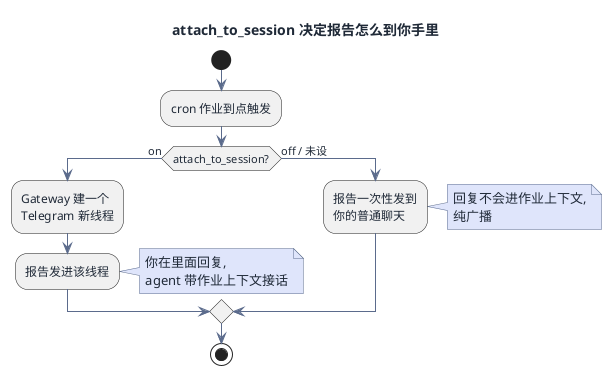
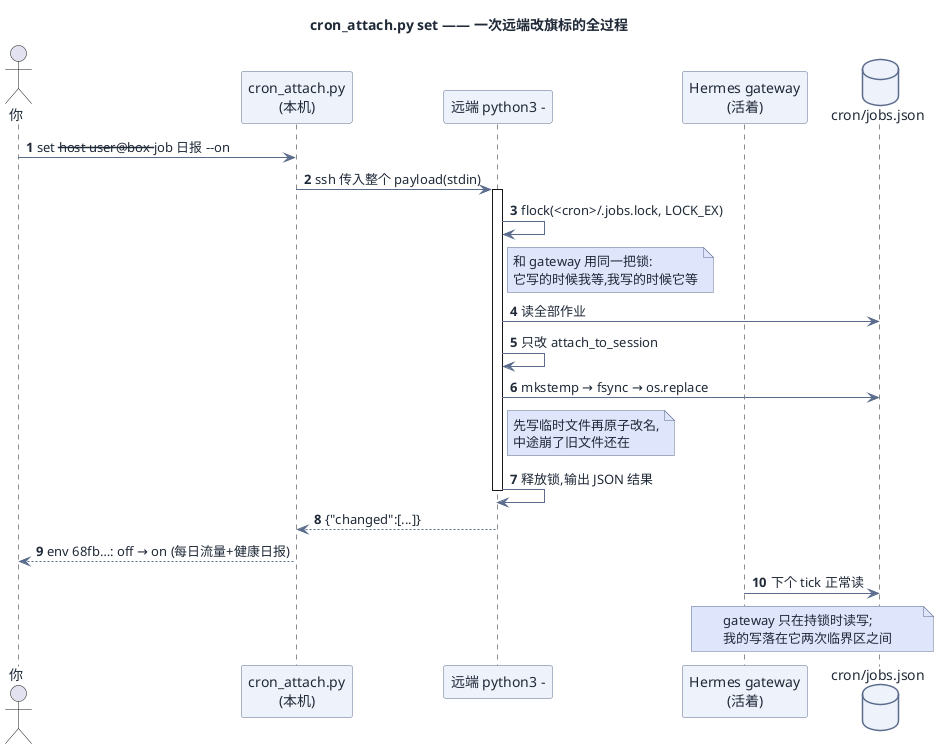

# Hermes 定时作业线程开关
(English: hermes-cron-attach)

[English](README.en.md) · 简体中文

开关 Hermes Agent cron 作业的 `attach_to_session`,本机或跨机队都行。

开着 = 作业报告落到 Telegram 独立可续聊的线程(新会话);关掉 = 一次性广播。本工具只负责改开关,投递和线程由 Hermes gateway 完成。

## 为什么需要它

`hermes cron edit` 没有 `--attach` 旗标,改 `cron/jobs.json` 是唯一路径,而这个文件归活着的 gateway 管。本工具在远端 `<cron>/.jobs.lock` 上 flock(和 gateway 同一把跨进程锁)后读写,用 `mkstemp`+`os.replace` 原子替换,只动 `attach_to_session` 一个字段。

## 一眼看懂

**开关开和关,区别是什么:**



**一次 `set` 在远端实际做了什么(为什么不会撞坏 gateway):**



## 安装

单文件,只用标准库。Python 3.8+。

```bash
curl -O https://raw.githubusercontent.com/getaskclaw/hermes-cron-attach/main/cron_attach.py
chmod +x cron_attach.py
```

## 用法

```bash
./cron_attach.py list --host local                    # 本机,不走 SSH
./cron_attach.py list --host user@1.2.3.4             # 直连远端
./cron_attach.py list --host 1.2.3.4 --user root --port 22 --key ~/.ssh/id_ed25519

./cron_attach.py set --host local --job "日报" --on --dry-run   # 先看不改
./cron_attach.py set --host local --job 68fb7aa1d644 --on
./cron_attach.py set --host user@1.2.3.4 --all-jobs --off
./cron_attach.py set --host local --job backup --on --profile myprofile

./cron_attach.py list --nodes nodes.json --node all   # 名册模式
./cron_attach.py set --node web-1 --nodes nodes.json --job 巡检 --on
```

`--job` 传精确 job id 或名字子串(大小写不敏感)。匹配多个默认拒绝并列出候选,`--force-multi` 放行。无匹配的 home 只记 `skipped`,不算错——多 profile 的机器很正常。

## 安全要点

- 远端拿 `<cron>/.jobs.lock` 的排他 flock 才读写,不会和 scheduler 的写交叉。
- mkstemp + fsync + os.replace,中途崩溃留旧文件。
- 只改 `attach_to_session`,其余字段与文件顶层键原样保留。
- gateway 的 shrink-merge 只恢复缺失 id,同 id 字段以持锁方为准,改动不会被吃。
- home 发现扫 `$HERMES_HOME`、SSH 用户 `~/.hermes`、`/root/.hermes`、`/home/*/.hermes` 及各自 `profiles/*`,按 realpath 去重——SSH 用户和 Hermes 用户经常不同。
- 远端不落盘:payload 走 SSH stdin(`ssh host 'python3 -'`),除 jobs.json 编辑外不写目标文件系统。

## 名册格式(可选,仅 --node 用)

```json
{"nodes": {
  "web-1": {"ip": "1.2.3.4", "ssh": {"user": "root", "port": 22}},
  "me":    {"ip": "127.0.0.1", "ssh": {"local": true}},
  "jumped": {"ip": "10.0.0.7", "ssh": {"command_argv": ["ssh", "bastion", "ssh -o BatchMode=yes 10.0.0.7 'python3 -'"]}}
}}
```

`command_argv` 是跳链逃生口:最后一项是远端命令,工具往它后面追加 mode + base64 参数。

## 不做什么

- 不发消息,投递仍是 gateway 的事。
- 不做会话 seeding——续聊是 gateway 侧状态,本工具不复刻。
- 不在远端安装任何东西。

## 出处

为管理多台 VPS 上的 Hermes 实例而写;`attach_to_session` 字段语义见 Hermes Agent 源码 `cron/scheduler_delivery.py`。

## 许可证

MIT——见 [LICENSE](LICENSE)。
